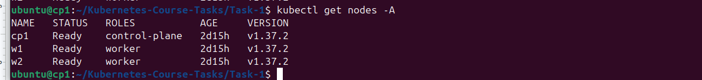
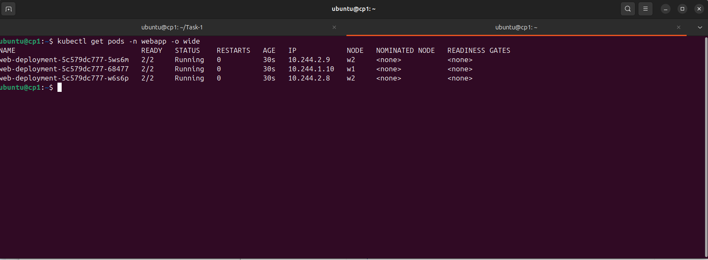
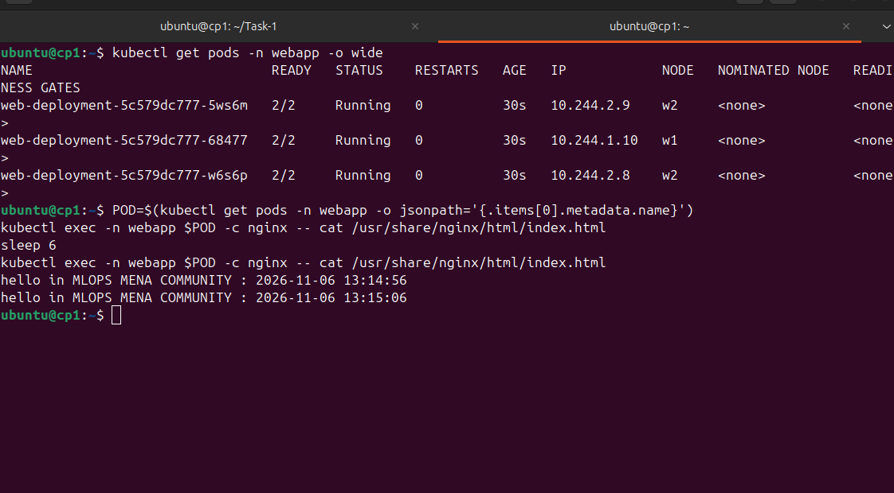
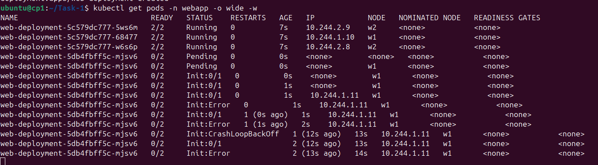
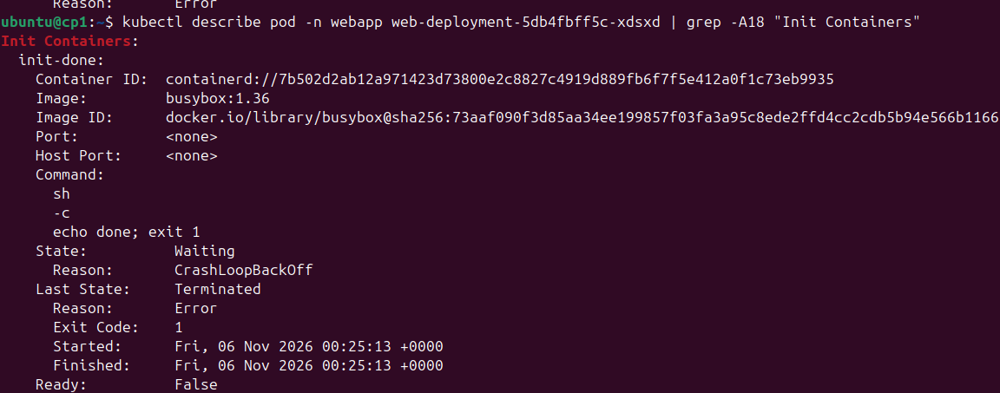
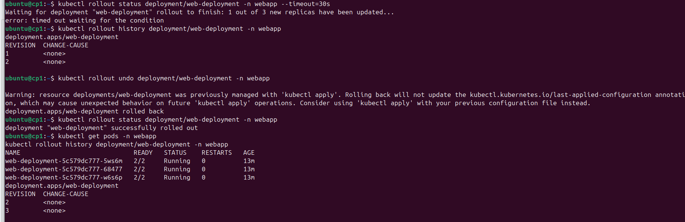
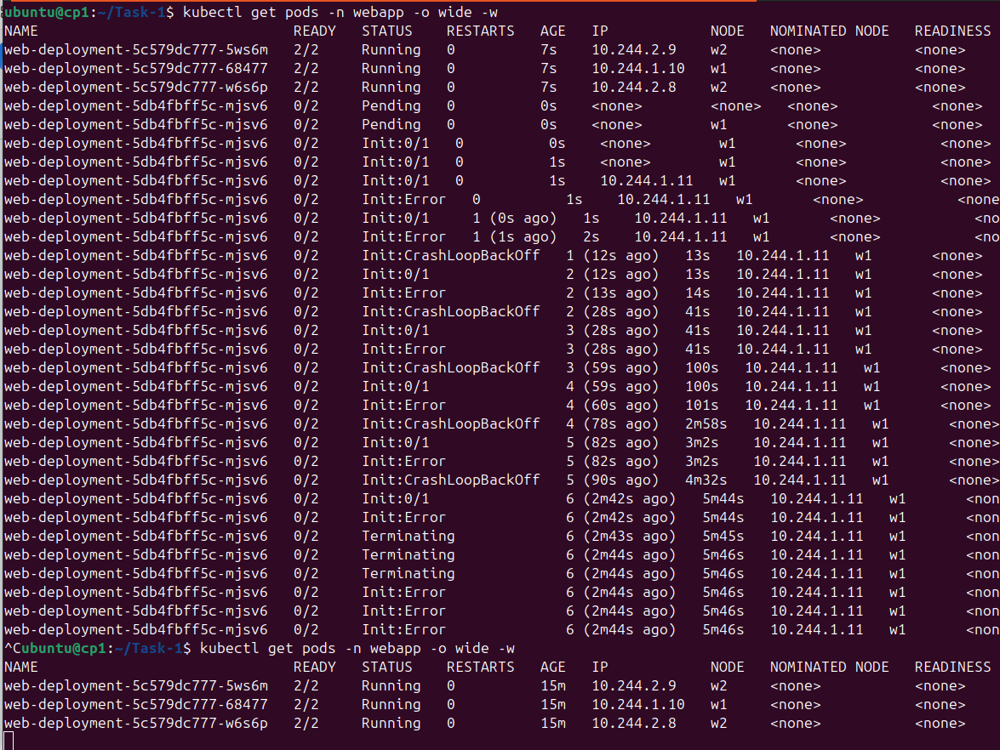

# Task 1: Multi-Container Pods (Init Container & Sidecar)

Deploy an Nginx "hello" page where each Pod runs three containers (init, main, sidecar) sharing a process namespace, with no volumes and no custom image. Then break the init container on purpose and roll back.

## Environment

- Cluster: kubeadm on 3 KVM virtual machines (1 control-plane + 2 workers), Kubernetes v1.37.2
- CNI: Flannel
- Namespace: `webapp`
- Deployment: `web-deployment` (3 replicas)

## Files

- `namespace.yaml`: creates the `webapp` namespace
- `deployment.yaml`: the Deployment with the init container, nginx, and the time-updater sidecar

## Pod design

| Container | Type | Role |
|---|---|---|
| `init-done` | init | prints `done` and exits 0; the other containers start only if it succeeds |
| `nginx` | main | writes the initial `index.html` with the timestamp and serves it on port 80 |
| `time-updater` | sidecar | every 5 seconds rewrites `index.html` through `/proc/<nginx-pid>/root` |

`shareProcessNamespace: true` lets the sidecar see the nginx process, so it can write into nginx's filesystem through `/proc/<pid>/root` without a shared volume. The sidecar runs as root (`runAsUser: 0`) to be allowed to do that.

## Steps

### 1. Cluster

```bash
kubectl get nodes
```



### 2. Namespace

```bash
kubectl apply -f namespace.yaml
```

### 3. Deploy and check

```bash
kubectl apply -f deployment.yaml
kubectl get pods -n webapp -o wide
```

All 3 Pods reach `2/2 Running` (the init container is not counted in READY).



### 4. Timestamp updates

```bash
POD=$(kubectl get pods -n webapp -o jsonpath='{.items[0].metadata.name}')
kubectl exec -n webapp $POD -c nginx -- cat /usr/share/nginx/html/index.html
sleep 6
kubectl exec -n webapp $POD -c nginx -- cat /usr/share/nginx/html/index.html
```

The time changes between the two reads.



### 5. Make the init container fail

Changed the init command to `echo done; exit 1` and applied the file.

```bash
kubectl apply -f deployment.yaml
kubectl get pods -n webapp -w
```

The new Pod goes through `Init:Error` then `Init:CrashLoopBackOff`, while the 3 old Pods stay `2/2 Running`. The rolling update will not remove an old Pod until a new one is Ready, so there is no downtime.



Diagnosis:

```bash
kubectl describe pod -n webapp <failed-pod>
kubectl logs -n webapp <failed-pod> -c init-done
kubectl rollout status deployment/web-deployment -n webapp
kubectl rollout history deployment/web-deployment -n webapp
```

`describe` shows `Exit Code: 1` for `init-done`. `rollout status` stays at "1 out of 3 new replicas have been updated" and times out.




### 6. Fix: rollback

```bash
kubectl rollout undo deployment/web-deployment -n webapp
kubectl rollout status deployment/web-deployment -n webapp
kubectl get pods -n webapp
```

The failed Pod is removed and the 3 original Pods are still `2/2 Running`. I also restored `deployment.yaml` to the working version so the file matches the cluster.



## What I learned

- Init containers must exit 0 before the other containers start; failures show as `Init:Error` then `Init:CrashLoopBackOff`.
- A sidecar runs next to the main container for the whole life of the Pod.
- `shareProcessNamespace` lets containers in one Pod see each other's processes.
- A rolling update keeps old Pods alive until the new ones are Ready, and `kubectl rollout undo` restores the previous revision.
