# Task 2: FastAPI + MySQL with ConfigMap, Secret, PV/PVC and Ingress

A two-tier guestbook on Kubernetes: a FastAPI app (2 replicas) backed by MySQL, with externalized configuration, persistent storage and Ingress routing.

```
Browser -> Ingress Controller -> Ingress webapp-ingress -> Service webapp-api (80 -> 8000) -> 2 app Pods
App -> Service mysql (3306) -> MySQL Pod -> mysql-pvc -> mysql-pv (hostPath on minikube-m02)
```

## Environment

- minikube, 3 nodes (1 control-plane + 2 workers), Docker driver
- Namespace: `webapp-stack`
- Images: `webapp-api:task2`, `webapp-mysql:task2` (built locally, loaded with `minikube image load`)
- Ingress controller: minikube `ingress` addon (nginx)

## Files

| File | Purpose |
|---|---|
| `webapp/`, `mysql/` | provided app and database sources with Dockerfiles |
| `01-namespace.yaml` | namespace `webapp-stack` |
| `02-secret.yaml` | `mysql-secret` (root-password, app-user, app-password) |
| `03-configmap.yaml` | `webapp-config` (APP_TITLE, APP_ENV, MYSQL_HOST, MYSQL_PORT, MYSQL_DATABASE) |
| `04-pv-pvc.yaml` | `mysql-pv` (2Gi, hostPath, nodeAffinity to `minikube-m02`) and `mysql-pvc` |
| `05-mysql.yaml` | MySQL Deployment (`Recreate`) and Service |
| `06-webapp.yaml` | app Deployment (2 replicas) and Service |
| `07-ingress.yaml` | Ingress `webapp-ingress` |

## Steps

### 1. Build the images and load them into minikube

```bash
docker build -t webapp-api:task2 ./webapp
docker build -t webapp-mysql:task2 ./mysql
minikube image load webapp-api:task2
minikube image load webapp-mysql:task2
minikube image ls | grep task2
```

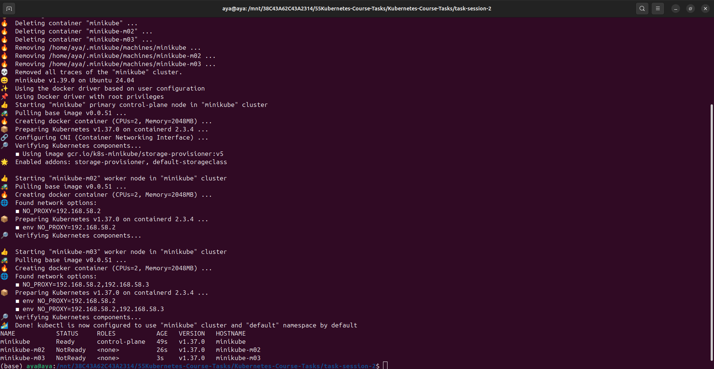
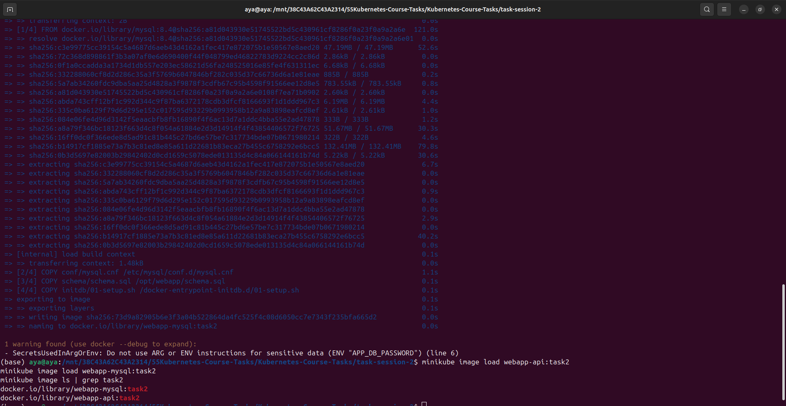

### 2. Namespace, Secret and ConfigMap

```bash
kubectl apply -f 01-namespace.yaml
kubectl apply -f 02-secret.yaml
kubectl apply -f 03-configmap.yaml
kubectl get secret mysql-secret -n webapp-stack
kubectl get configmap webapp-config -n webapp-stack
```

The Secret has 3 keys and the ConfigMap has 5. `MYSQL_PORT` is kept in the ConfigMap as `"3306"` so it overrides the variable `MYSQL_PORT=tcp://...` that Kubernetes injects for the `mysql` Service.

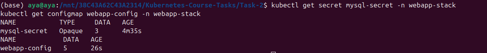

### 3. PV and PVC

```bash
kubectl apply -f 04-pv-pvc.yaml
kubectl get pv mysql-pv
kubectl get pvc mysql-pvc -n webapp-stack
```

The PV is pinned to `minikube-m02` with nodeAffinity, because a hostPath folder exists on one node only. Both objects use `storageClassName: manual` and are `Bound`.

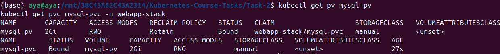

### 4. MySQL and the application

```bash
kubectl apply -f 05-mysql.yaml
kubectl apply -f 06-webapp.yaml
kubectl get deploy -n webapp-stack
kubectl get pods -n webapp-stack -o wide
```

MySQL uses `strategy: Recreate` so two servers never share the same data folder. It runs on `minikube-m02`.

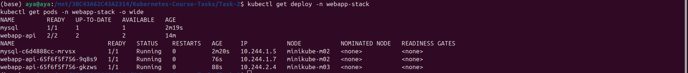

Default data created by the init script:

```bash
kubectl exec -n webapp-stack deploy/mysql -- sh -c 'mysql -uroot -p"$MYSQL_ROOT_PASSWORD" -e "SELECT * FROM webapp.messages"'
```

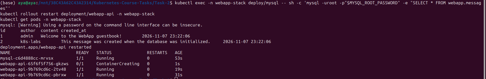

### 5. Ingress

```bash
minikube addons enable ingress
kubectl apply -f 07-ingress.yaml
kubectl get ingress webapp-ingress -n webapp-stack
kubectl port-forward -n ingress-nginx svc/ingress-nginx-controller 8080:80
```

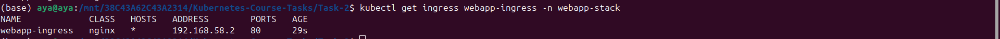

### 6. Access through the Ingress

```bash
curl http://localhost:8080/api/info
```

The response shows `"version":"task2"`, the title and environment from the ConfigMap, and the MySQL server name.

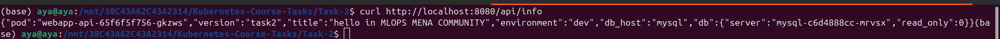

Write and read a message:

```bash
curl -X POST http://localhost:8080/api/messages -H "Content-Type: application/json" -d '{"author":"student","content":"hello"}'
curl http://localhost:8080/api/messages
```

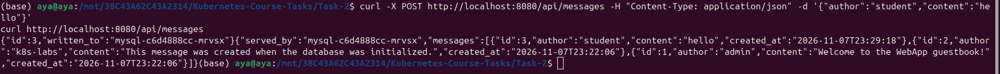

### 7. Data persistence after deleting the MySQL Pod

```bash
kubectl delete pod -n webapp-stack -l app=mysql
kubectl get pods -n webapp-stack -l app=mysql -o wide -w
curl http://localhost:8080/api/messages
```

The new Pod (`mysql-c6d4888cc-gdwgt`) started on `minikube-m02` again.

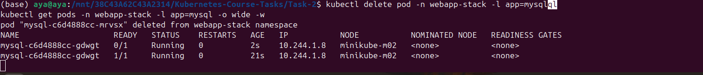

The message `student / hello` (id 3) is still there, and `served_by` shows the new Pod name. The data lives on the PV, not inside the container.

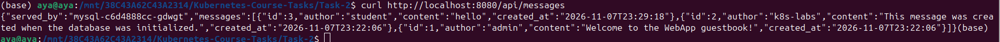

## Problem I faced and how I fixed it

After the first start, `SELECT * FROM webapp.messages` returned `Unknown database 'webapp'`. The MySQL logs (`kubectl logs deploy/mysql --previous`) showed that the init script failed:

```
01-setup.sh: line 9: mysql_note: command not found
01-setup.sh: line 10: docker_process_sql: command not found
```

The official MySQL entrypoint runs `.sh` files in `/docker-entrypoint-initdb.d/` with `source` when they are not executable, which gives the script access to those helper functions. When the file is executable, it is run as a separate program and the functions are not found. My project was on an external disk where every file is `rwxrwxrwx`, so the script was copied as executable.

Fix: copy the project to the home folder, run `chmod -x mysql/initdb/01-setup.sh`, rebuild the image, reload it into minikube, delete the MySQL Deployment, empty the data folder (`minikube ssh -n minikube-m02 -- sudo rm -rf /data/webapp-mysql`) and apply `05-mysql.yaml` again. The database is created only on the first start with an empty folder, so the folder had to be emptied.

Note: `mysql/initdb/01-setup.sh` must not be executable when building the image (`chmod -x`).

## What I learned

- ConfigMap holds normal settings and Secret holds credentials; both are injected as environment variables.
- PV is cluster-wide storage; PVC is a request that binds to it by `storageClassName` and `volumeName`.
- nodeAffinity keeps a hostPath volume on the node where the data is.
- Service names work as DNS names inside a namespace.
- Ingress routes HTTP traffic from outside to a Service through an Ingress controller.
- Data survives Pod deletion when it is stored on a PersistentVolume.
