# Task 3 & 4: MySQL Read Replicas, RBAC, NetworkPolicy and Helm

The Task 2 stack grown into a write/read MySQL setup, deployed by a restricted user (`dev-user`) with a Helm chart, and protected by a NetworkPolicy.

Browser -> Ingress -> Service webapp-api -> 2 app Pods
App writes -> mysql-write (source) App reads -> mysql-read (2 replicas)
mysql-read pulls changes from mysql-write (GTID replication)
All MySQL Pods share mysql-pvc (write/ and read/<pod>/ sub folders)


## Environment

- minikube, 3 nodes, Docker driver, **Calico CNI** (needed for NetworkPolicy)
- Namespace `webapp-stack`
- Images `webapp-api:task3`, `webapp-mysql:task3`

## Structure

| Path | Purpose |
|---|---|
| `webapp/`, `mysql/` | provided sources (task3) |
| `rbac/` | CSR, Role, RoleBinding, ClusterRole, ClusterRoleBinding |
| `manifests/` | plain YAML files (never applied directly) |
| `webapp-stack/` | Helm chart built from the manifests |

The private key `dev-user.key` is not in the repository.

## Steps

### 1. Cluster with Calico

```bash
minikube start --nodes 3 --driver=docker --cni=calico --cpus=2 --memory=2048mb
kubectl get nodes
kubectl get pods -n kube-system -l k8s-app=calico-node
kubectl create namespace webapp-stack
```

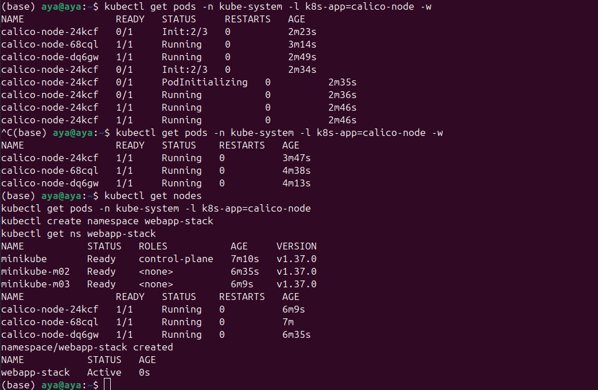

### 2. Build and load the task3 images

```bash
docker build -t webapp-api:task3 ./webapp
docker build -t webapp-mysql:task3 ./mysql
minikube image load webapp-api:task3
minikube image load webapp-mysql:task3
```

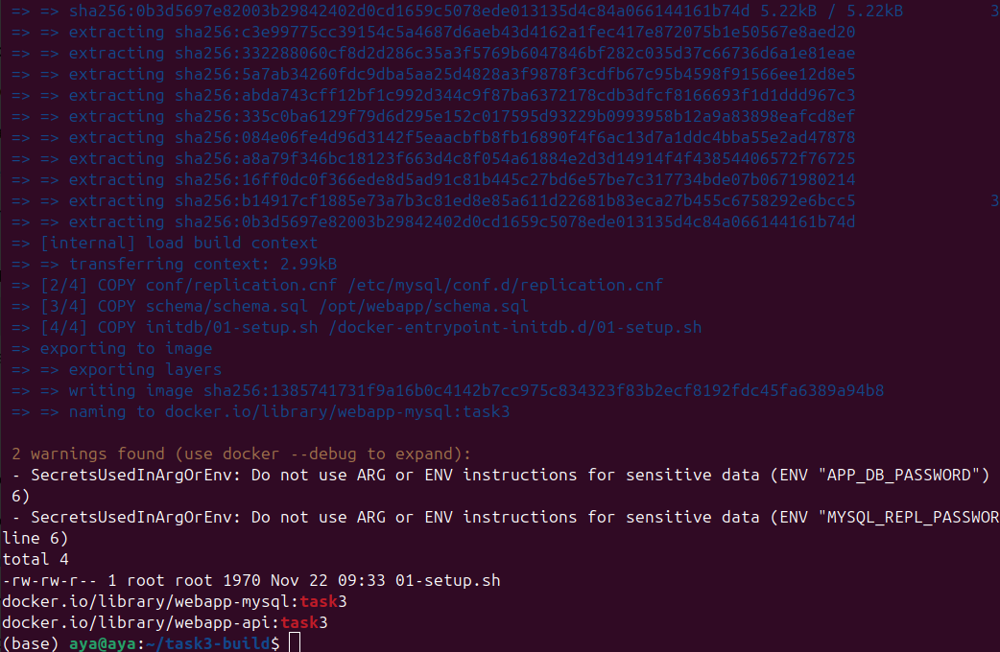

### 3. Create `dev-user` (certificate)

```bash
openssl genrsa -out dev-user.key 2048
openssl req -new -key dev-user.key -out dev-user.csr -subj "/CN=dev-user/O=webapp-devs"
kubectl apply -f csr.yaml
kubectl certificate approve dev-user
kubectl get csr dev-user -o jsonpath='{.status.certificate}' | base64 -d > dev-user.crt
```

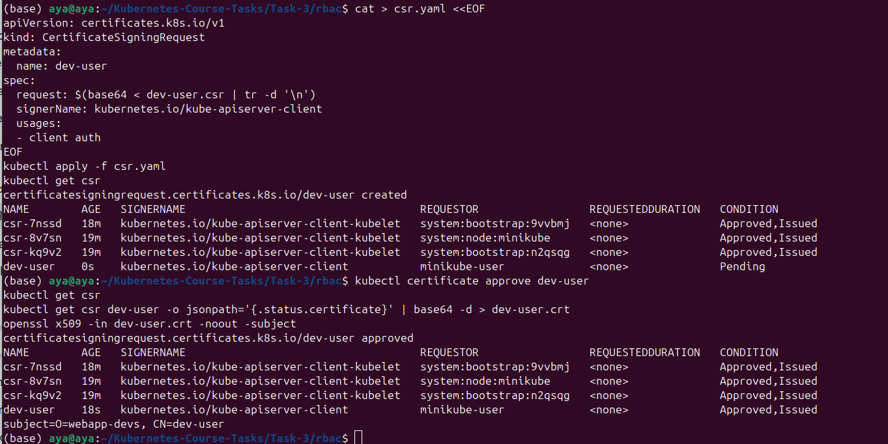

### 4. Rights (RBAC)

`webapp-developer` Role + RoleBinding in `webapp-stack`, and `pv-manager` ClusterRole + ClusterRoleBinding for PVs.

```bash
kubectl apply -f rbac/role.yaml
kubectl apply -f rbac/clusterrole.yaml
kubectl auth can-i create deployments -n webapp-stack --as dev-user
kubectl auth can-i create persistentvolumes --as dev-user
kubectl auth can-i get nodes --as dev-user
```

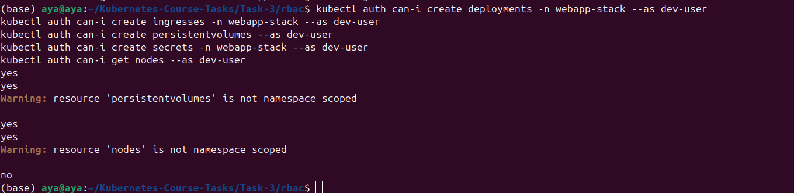

### 5. kubeconfig

```bash
kubectl config set-cluster k8s-lab --server=$SERVER --certificate-authority=$HOME/.minikube/ca.crt --embed-certs=true
kubectl config set-credentials dev-user --client-certificate=dev-user.crt --client-key=dev-user.key --embed-certs=true
kubectl config set-context dev-user@k8s-lab --cluster=k8s-lab --user=dev-user --namespace=webapp-stack
kubectl config use-context dev-user@k8s-lab
kubectl auth whoami
```

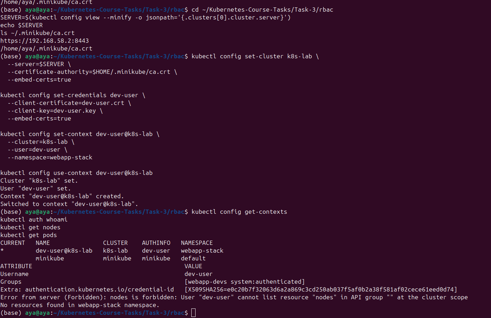

### 6. Manifests (not applied) and dry-run

Secret (adds `replication-password`), ConfigMap (`MYSQL_WRITE_HOST`, `MYSQL_READ_HOST`), PV/PVC, `mysql-write` (subPath `write`), `mysql-read` (2 replicas, `subPathExpr: read/$(POD_NAME)`), app, NetworkPolicy and Ingress. They were only tested with `kubectl apply --dry-run=server`.

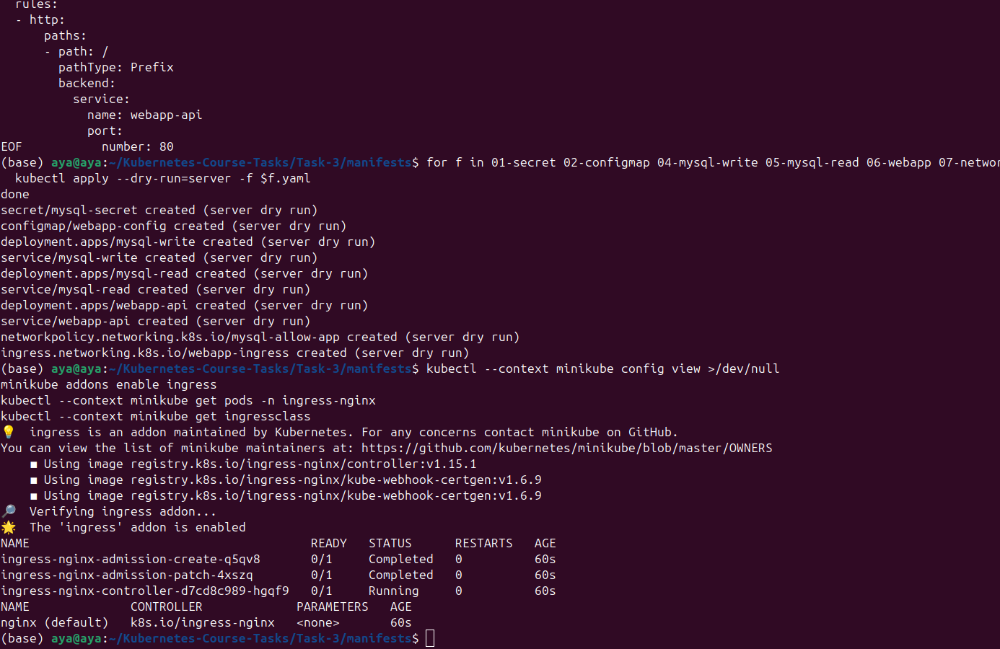

### 7. Helm chart

Namespace comes from `{{ .Release.Namespace }}`; replicas, images and storage sizes are in `values.yaml`.

```bash
helm lint webapp-stack
helm template webapp webapp-stack -n demo
```

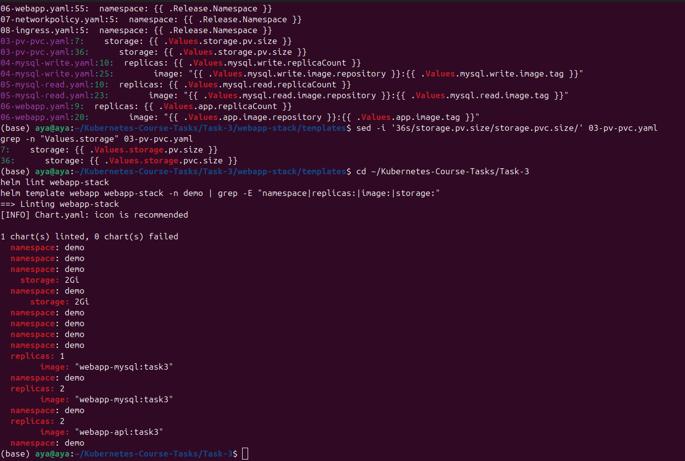

### 8. Install as dev-user

```bash
minikube addons enable ingress          # admin
helm install webapp ./webapp-stack -n webapp-stack
kubectl get deploy -n webapp-stack -o wide
```

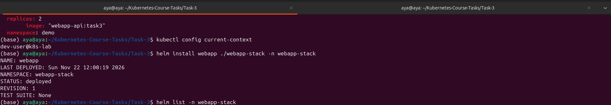


## Verification

**Identity, no rights outside the namespace, and one data folder per read Pod**

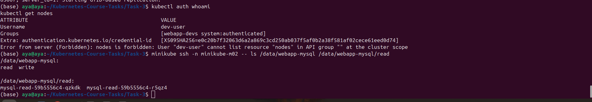

**Replication is running**

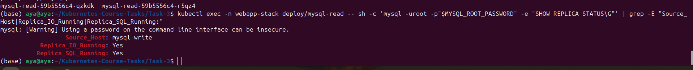

**The replica is read-only (`--super-read-only`)**

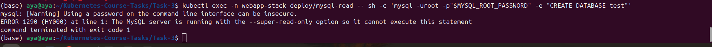

**App environment and objects** (`MYSQL_WRITE_HOST`, `MYSQL_READ_HOST`, no `MYSQL_HOST`)

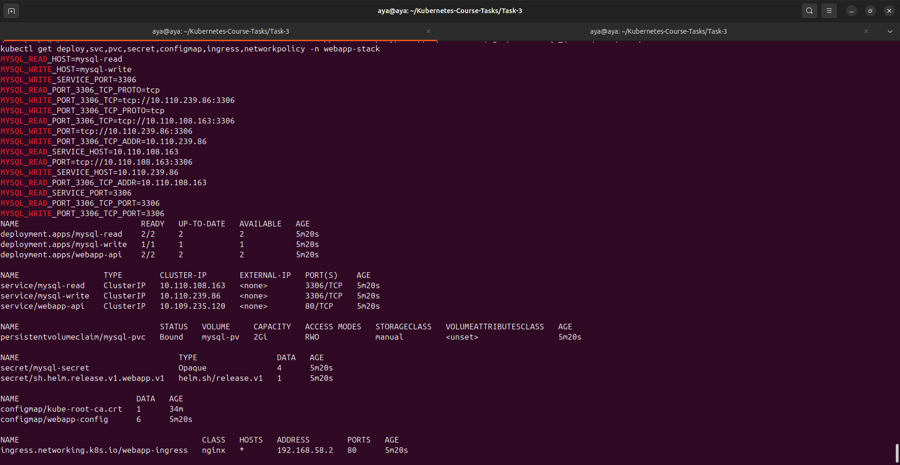

**App info: writes go to `mysql-write`, reads come from `mysql-read`**

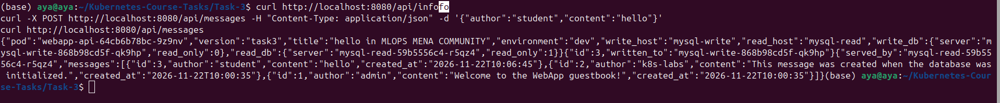


**NetworkPolicy:** the app connects, a random Pod times out

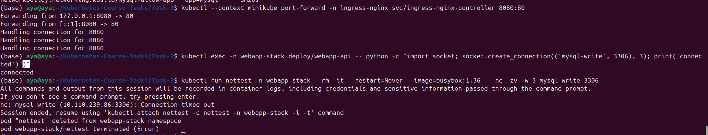

**Helm upgrade** (`--set app.replicaCount=3` gives 3/3) **and rollback** (back to 2/2)

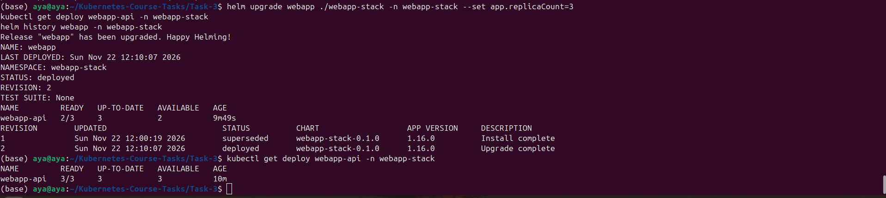
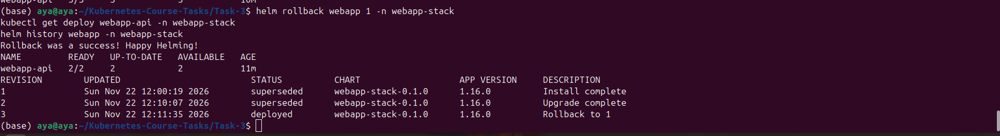

## Problems I faced

1. **Docker disk full (99%).** `minikube start` refused to run (`RSRC_DOCKER_STORAGE`). I freed space (`docker system prune -a`, removed old VMs and files) until about 32 GB were free.
2. **The old cluster used kindnet, not Calico.** NetworkPolicy would not be enforced, so check 14 could not work. I recreated the cluster with `--cni=calico`.
3. **Executable init script.** From Task 2, the MySQL init script must not be executable when the image is built (`chmod -x`), so the images were built from a copy in the home folder. I confirmed it inside the image with `docker run --rm --entrypoint ls webapp-mysql:task3 -l /docker-entrypoint-initdb.d/`.
4. **Replica started before the source.** The first connection failed (`attempt 1/8640`) and succeeded 10 seconds later, as the task describes.

## What I learned

- A Kubernetes user is whoever holds a certificate signed by the cluster CA: CN is the name, O is the group.
- Role works in one namespace; ClusterRole is needed for cluster-wide objects such as PVs.
- `subPath` and `subPathExpr` let several Pods share one PVC without sharing a data folder.
- A NetworkPolicy only works if the CNI enforces it (Calico).
- Helm packages manifests with values, and supports upgrade and rollback.
